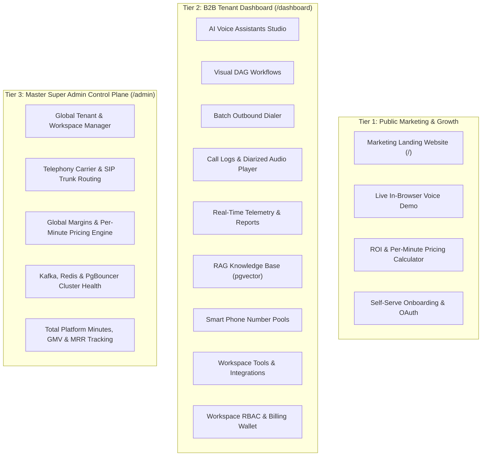

## 1. Executive System Overview & 3-Tier Product Architecture

CallAgent is a high-throughput, enterprise-grade AI Voice & Chat Agent SaaS platform designed to build, test, deploy, and monitor autonomous conversational agents. The system is architected across **3 distinct product tiers**:

---

### 1.1 Tier 1: Public Marketing Landing Website (`/`)
- **Modern High-Converting Aesthetics**: Sleek dark/light theme with glassmorphism, fluid micro-interactions, and Google Inter typography.
- **Interactive In-Browser Voice Demo**:
  - Visitors can click a "Talk to Tiffany" button and speak directly to an AI agent via WebRTC/Microphone in real-time.
  - Live audio waveform visualizer and streaming subtitle transcription.
- **Interactive Feature Showcase**:
  - Tabbed interactive demo showing Inbound Support, Outbound Sales, EMI Reminders, and Lead Qualification.
- **Multilingual Voice Showcase**:
  - Audio players letting prospective clients listen to native voices in English, Hindi, Hinglish, Tamil, Spanish, etc.
- **ROI & Cost Calculator**:
  - Interactive slider comparing human call center cost vs AI agent cost ($0.08/min or ₹10/min vs human agent salaries).
- **Authentication & Onboarding**:
  - Email/Password login, Google OAuth, and OTP verification via WhatsApp/SMS.
  - Automatic trial credit grant (e.g., ₹100 or $5 free dialing minutes).

---

### 1.2 Tier 2: B2B Multi-Tenant Client Dashboard (`/dashboard`)
*(Detailed in Section 2 & 3 below — 100% feature symmetry with Ringg.AI).*

---

### 1.3 Tier 3: Master Super Admin Control Plane (`/admin`)
- **Multi-Tenant Organization Directory**:
  - Search, inspect, impersonate, and manage all B2B client organizations.
  - Suspend workspaces, adjust concurrency limits, grant promotional wallet credits.
- **Telephony & Carrier Gateways Management**:
  - Configure wholesale SIP trunks (Twilio, Plivo, Exotel, Tata Tele, Ringg SIP).
  - Global carrier routing rules and failover thresholds.
- **Rate Cards & Margin Engine**:
  - Set wholesale cost vs retail pricing per country and provider.
  - Automated margin calculation (e.g. carrier cost ₹4.50/min, billed to client at ₹10.00/min).
- **Infrastructure & Cluster Health Monitor**:
  - Real-time Redis cluster memory usage & distributed lock contention.
  - Apache Kafka / Redpanda consumer group lag and throughput (msgs/sec).
  - PgBouncer active connection pool saturation.
  - Active global concurrent calls across all tenants.
- **Global Revenue & Financials**:
  - Total minutes consumed across all tenants today / this month.
  - Gross Margin Value (GMV), Monthly Recurring Revenue (MRR), and unearned wallet float.

---

## 2. Top-Level Navigation & Global Shell

### 2.1 Top Navigation Bar (Header)
- **Workspace Switcher Dropdown**:
  - Displays current active workspace (e.g., `Firoz Mohammad's Workspace`).
  - Allows creating new workspaces, switching between organization accounts, and viewing member roles (`Owner`, `Admin`, `Member`).
- **Global Search (`Cmd + K`)**:
  - Modal search dialog indexing Assistants, Workflows, Campaigns, Phone Numbers, and Call Logs by ID or name.
- **Wallet & Billing Balance Badge**:
  - Real-time balance display (e.g., `₹119.96` or `$USD`).
  - Click-to-recharge button triggering instant payment gateway modal (Razorpay / Stripe).
  - Low-balance visual alert indicator when balance falls below configurable threshold.
- **Help & Documentation (`?`)**:
  - Quick links to API documentation, Webhook testing guides, SDKs, and support ticket submission.
- **User Profile Menu**:
  - Displays avatar, name, email (`firozm613@gmail.com`).
  - Links to Account Settings, Password & Security, API Keys, and Logout.

### 2.2 Global Sidebar Navigation
Divided into structured categorical sections:
- **Core Platform**:
  - 🤖 **Assistants**: Voice & chat agent builder, single-node studio, versioning, prompt configuration.
  - 🔀 **Workflows**: Multi-agent visual DAG canvas, conditional branching, delay nodes, cross-channel handoffs.
- **Monitor**:
  - 📜 **Logs**: Real-time & historical call logs (Phone, WhatsApp, Workflows), audio playback, transcripts, sentiment, latency waterfall.
  - 📢 **Campaigns**: Batch outbound dialing manager, CSV contact list ingestion, retry logic, concurrency throttling.
  - 📊 **Analytics**: Aggregate metrics, call volume, connectivity rate, average handle time (AHT), cost tracking, latency breakdown, cohort retention, concurrency graphs.
  - 🛡️ **Evals**: Automated LLM-as-a-judge quality assurance, conversation grading criteria, accuracy benchmarks.
  - 🔔 **Alerts**: Real-time anomaly monitors (disconnection spike, customer hangup spike, low balance, high latency).
- **Inventory**:
  - 📚 **Knowledge Base**: Document repository (PDF, DOCX, TXT), website crawler, vector embeddings with chunking configuration.
  - 🔢 **Numbers**: Telephony management, DID purchase, BYO SIP trunks (Twilio, Plivo, Exotel), smart number pools with spam avoidance.
  - 🛠️ **Tools**: Custom API webhooks, DTMF generation, calendar scheduling, human call transfer, WhatsApp template triggers.
- **Labs & Settings**:
  - 🎙️ **STT Labs**: Speech-to-text accuracy benchmark, latency tester, language model comparison.
  - 🐛 **Report a Bug**: In-app feedback & bug reporting with screenshot and browser environment capture.
  - ⚙️ **Settings**: Workspace team members, company details, concurrency limits, API access keys, billing plans.

---

## 3. Module-by-Module Detailed Feature Breakdown

### 3.1 Assistants Studio (`/dashboard/assistants`)

#### A. Assistants List View
- **Channel Filter**: Filter agents by channel (`All`, `Voice`, `WhatsApp`, `WebCall`).
- **Search Bar**: Debounced search by Agent Name, ID, or description.
- **Create Agent Button & Multi-Stage Modal**:
  - Triggers the **Create Assistant Modal** with tabs across channels:
    - `Outbound`, `Inbound`, `Webcall`, `WhatsApp`
  - **Creation Modes**:
    - **Single Prompt**: "Create assistant from scratch for simple workflows."
    - **Multi Prompt**: "Create assistant from scratch for complex workflows."
  - **12 Live Industry Pre-Built Templates**:
    1. **Upcoming EMI Reminder (Pre-due)**: Automated courtesy call for upcoming EMI payments to ensure timely collection.
    2. **NDR Delivery Resolution**: Reschedules failed deliveries or confirms cancellations to minimize RTO (Return to Origin).
    3. **Credit Card Lead Qualification**: Qualifies pre-approved leads and confirms interest in credit card offers.
    4. **Pre-Approved Loan Qualification**: Verifies eligibility for pre-approved loans and sends an application link.
    5. **Recruitment - Initial Candidate Screening**: Screens applicants for experience, notice period, and salary expectations; shortlists based on requirements.
    6. **Loan Eligibility and Data Collection Agent**: Qualifies leads by verifying eligibility and collecting financial details.
    7. **Abandoned Cart Recovery**: Re-engages shoppers to resolve issues and complete pending purchases.
    8. **E-commerce Sale Announcement**: Proactively informs customers about upcoming sales and exclusive offers to drive online and in-store engagement.
    9. **Test Drive Booking**: Outbound calling agent to book test drives for prospective automotive leads.
    10. **Policy Renewal Reminder**: Outbound agent of an insurance platform to remind policyholders about upcoming policy renewals.
    11. **Medicine Refill Reminder**: Outbound agent of a healthcare platform to remind patients about upcoming medicine refills.
    12. **Demo Class Booking**: Outbound agent of an EdTech platform to schedule and book live demo class sessions.
- **Top Header Actions in Studio**:
  - `Test assistant` Button: Prominent top-right black action button launching the live WebRTC/WebCall audio testing drawer using the assistant's public test key (`pk_live_...`).
- **Agent Cards / Table**:
  - Agent Display Name (e.g., `Tiffany from RINGG AI`).
  - Badges: Agent Type (`Voice`, `Outbound`, `Inbound`), Active Version (`v1`), Status (`Live`, `Draft`).
  - Activity Metrics: Total calls processed, last edited timestamp.
  - Actions: Quick test call (Webcall), Star/Favorite, Duplicate, Delete, View Analytics.

#### B. Create Assistant Wizard (`/dashboard/assistants/new/single-node/[id]`)

When a user selects **"Single Prompt"** from the template modal, they are routed to the comprehensive Assistant Creation Wizard:

1. **Left Sidebar Preview Card**:
   - Card displays `Single Prompt` badge and description: *"Create assistant from scratch for simple workflows."*

2. **Section 1: Agent Basics**:
   - `Agent Name *`: Required text field (e.g. `Tiffany Inbound Specialist`).
   - `Primary Language *`: Required dropdown (Default: `English (IN)`, with support for 50+ locales).
   - `Secondary Language`: Optional dropdown (Options: `None`, `Arabic`, `Bengali`, `Burmese (Myanmar)`, `Dutch`, `English (UK)`, `English (US)`, `Hindi`, `Tamil`, `Spanish`, `French`, etc.).

3. **Section 2: Set Up Voice**:
   - **Provider Filter Tabs**: `All`, `Azure`, `Cartesia`, `ElevenLabs`, `Google`, `Sarvam`.
   - **Voice Persona Cards** (with instant sample playback preview button):
     - `Tiya` (Neutral tone)
     - `Riya (Sonic-3.5)` (Most Used badge)
     - `Kashish` (Neutral tone)
     - `Jai` (Neutral tone)
     - `Ankita` (Neutral tone)
     - `Richa` (Neutral tone)

4. **Section 3: Call Context**:
   - `Company *`: Text input ("Enter your company or organization name").
   - `Call Purpose *`: Textarea ("Briefly describe the main reason for your call and what you hope to achieve").
   - `Additional Info`: Textarea ("Include any other relevant information about your call or specific requirements").

5. **Section 4: Custom Variables**:
   - Context injection tags populated in the prompt:
     - Default system variables: `callee_name`, `mobile_number`.
     - `Enter new variable` text input with `Add ↵` keyboard trigger to add custom keys.

6. **Section 5: Knowledge Base**:
   - Select existing workspace knowledge base repository from dropdown or leave unattached.

7. **Section 6: Inbound Calling**:
   - Toggle/Dropdown: `Disabled` or `Enabled` (binds a dedicated inbound DID from the number inventory).

8. **Footer Actions & AI Prompt Synthesis Engine**:
   - `Back` button (returns to template modal).
   - `Create Assistant` primary action button:
     - On click, displays the **"Generating assistant prompt"** modal with an animated AI robot avatar and indeterminate progress bar (*"This usually takes under a minute"*).
     - Server-side LLM uses the provided Company, Call Purpose, Language, and Additional Info to automatically generate:
       - Friendly First Message greeting with dynamic `{{Callee Name}}` variable.
       - Persona Objective & Warm Tone instructions.
       - Language handling rules (Hinglish / native multilingual code-switching).
       - Structured 6-stage conversation flow (Greeting ➔ Exploration ➔ Pricing ➔ Verification ➔ Conclusion ➔ End Call Handling).
       - Inline FAQ anchors.
     - On completion, automatically assigns a unique UUID and redirects the user directly into the **Assistant Studio Canvas (`/dashboard/assistants/[new_id]?orchestration=single`)**.

##### 1. Prompt Sub-Section & AI Synthesis Architecture

The platform implements an advanced, human-like voice prompt engineering standard divided into **11 structural sections**:

1. **First Message (Greeting)**:
   - Dynamic variable injection: `Hi, this is {{agent_name}} calling from {{company}}. Am I speaking with {{Callee Name}}?`
   - **Interruptible Toggle**: Callee can interrupt instantly without the audio playing to completion.

2. **Persona Objective & Call Goals**:
   - Explicit persona definition (e.g. *"warm, professional, and efficient female calling representative from {{company}}"*).
   - Clear outcome-driven goals: *"Verify identity, confirm availability, collect required details related to {{call_purpose}}, and either complete the action or schedule a callback if busy."*

3. **Voice & Tone Guidelines**:
   - Short sentences, natural pacing suitable for spoken phone calls.
   - Warm but professional; helpful, not salesy.
   - One question at a time to maintain natural dialogue control.

4. **"NEVER Say" Blacklist (Anti-Patterns)**:
   - Eliminates robotic cliches:
     - ❌ *"That's a great question" / "Thank you for asking"*
     - ❌ *"Certainly" / "Indeed" / "Kindly" / "I acknowledge"*
     - ❌ *"Perfect!" / "Excellent!" / "Wonderful!" after every turn*
     - ❌ *"I am here to help you"*

5. **Natural Conversation Tricks (Human Speech Simulation)**:
   - **Sparingly Used Fillers**: *"Actually...", "So...", "Just to confirm...", "One quick thing..."*
   - **Brief Acknowledgments**: *"Okay...", "Right...", "Got it..."*
   - **Concise Turns**: Prohibits monologues; keeps turns under 2 sentences.
   - **Energy Mirroring**: If callee is brief ➔ stay brief; if callee asks details ➔ elaborate.

6. **Direct Answer Rule**:
   - Always answer the user's direct inquiry first before bridging back to the call objective.

7. **Smart Language Switching Thresholds**:
   - Default: `English (IN)` or primary locale.
   - Switch condition: Switch language only if callee speaks 2+ full sentences in another language OR asks explicitly.
   - Ignore false triggers: Do NOT switch language for loanwords or affirmations like *"okay"*, *"yes"*, *"haan"*, *"theek hai"*.

8. **TTS Phonetic & Currency Formatting Rules**:
   - Automatic SSML / Text pre-processing table before feeding text to TTS engines:
     | Raw Input Pattern | Pronounced SSML / Spoken Output |
     | :--- | :--- |
     | `₹5000` | *"five thousand rupees"* |
     | `15%` | *"fifteen percent"* |
     | `Jan 25` | *"twenty-five January"* |
     | `9876543210` | *"nine eight seven six..." (spaced with audio pauses)* |
     | `NCB` | *"N C B"* (spaced letters) |
     | `2.5x` | *"two and a half times"* |

9. **Zero-Trust Security Guardrails**:
   - Strict compliance filters: **NEVER ask for** `OTP`, `CVV`, `PIN`, `Aadhaar`, `PAN`, passwords, or full credit card numbers.
   - Out-of-scope containment: If caller insists on unsupported queries, politely apologize and end call.

10. **Context & Dynamic Variables**:
    - Dynamic key-value binding: `callee_name`, `mobile_number`, `amount_due`, `appointment_date`.

11. **Structured Multi-Step Branching Script (Decision Tree)**:
    - **Step 1: Opening & Verification**:
      - Confirm callee identity: `Hi, this is {{agent_name}} calling from {{company}}. Am I speaking with {{Callee Name}}?`
      - Branch handling: Wrong Person / "Who is this?" / Confirmed / Busy.
    - **Step 2: Context Alignment**:
      - Brief check: *"Calling regarding {{purpose}}. Is now a good time—just two minutes?"*
    - **Step 3: Main Value Proposition**:
      - Lead with direct customer benefit: *"I can get this sorted quickly so you don't have to follow up again."*
      - Ask for commitment: *"So should I go ahead and proceed with this now?"*
      - Outcomes: `IF Yes` ➔ Proceed to Closing; `IF Objection` ➔ Step 4; `IF Needs Expert` ➔ Transfer Subroutine.
    - **Step 4: Objection Handling Engine**:
      - Core psychological formula: **Acknowledge ➔ Reframe ➔ Soft Ask**.
      - Formulation: *"I understand. Actually, this will take less than two minutes. Do you want to do it now, or should I call you back at a better time?"*
    - **Step 5: Closing & Confirmation**:
      - Summarize agreed outcome and trigger graceful exit.

12. **Reusable Subroutines**:
    - **Callback Subroutine**: *"No problem. When should I call you back—today evening or tomorrow morning?"* ➔ Confirm time ➔ `[END CALL]`.
    - **Polite Exit Subroutine**: *"Okay, no worries. If you need anything later, you can reach out to {{company}}. Take care."* ➔ `[END CALL]`.
    - **Transfer Subroutine**: *"Sure, I'll connect you to the right person. Please hold."* ➔ `[Transfer to Human / SIP extension]` ➔ `[END CALL]`.

13. **Structured FAQ Engine (Trigger ➔ Response ➔ Action)**:
    - Every FAQ is parsed as a 3-part operational rule:
      - **Trigger**: `"Why are you calling?"`
        - **Response**: `"I'm calling from {{company}} regarding {{purpose}}."`
        - **Action**: `"Is now a good time—two minutes?"`
      - **Trigger**: `"Is this about my number {{mobile_number}}?"`
        - **Response**: `"Yes, this call is on the number ending with {{mobile_number}}."`
        - **Action**: `"Just confirming—are you the right person to speak to about {{purpose}}?"`
      - **Trigger**: `"How do I know this is legit?"`
        - **Response**: `"Don't share any OTP, PIN, or card details on calls. If you prefer, I can schedule a callback or you can verify via {{company}}'s official channel."`
        - **Action**: Offer callback or warm transfer.

14. **Few-Shot Scenario Trees (In-Prompt Grounding)**:
    - **Scenario 1: Happy Path**: Callee confirms identity ➔ consents to time ➔ agent asks qualifying question ➔ callee agrees ➔ agent confirms next step ➔ polite bye.
    - **Scenario 2: Objection ➔ Converted**: Callee is hesitant (*"Make it quick"*) ➔ agent acknowledges and reframes benefit (*"Sorted quickly so you don't have to follow up"*) ➔ callee agrees (*"Fine"*) ➔ completion.
    - **Scenario 3: Busy ➔ Callback**: Callee states busy ➔ agent asks preference (*"today evening or tomorrow morning?"*) ➔ schedules callback ➔ bye.
    - **Scenario 4: Edge Case — Transfer / Out of Scope**: Callee insists on speaking to a human (*"I want to talk to a person"*) ➔ agent immediately honors request without arguing (*"Sure. I'll connect you to the right person. Please hold."*) ➔ warm transfer execution.

##### 2. Voice Sub-Section
- **Primary Language Selector**: Multi-locale support (`en-IN`, `en-US`, `hi-IN`, `ta-IN`, `es-ES`, etc.).
- **Voice Model Selection**:
  - Voice Provider integration (ElevenLabs, Cartesia, Deepgram Aura, OpenAI TTS, Azure Speech).
  - Voice preview player with instant audio sample playback.
  - Voice Pitch, Stability, Similarity Boost, and Speaking Speed slider (0.5x to 2.0x).
- **Secondary Language & Multilingual Switching**:
  - Optional secondary language (e.g., `hi-IN` Hinglish).
  - Secondary Voice ID selection to maintain voice identity consistency across languages.
- **Pronunciation & Vocabulary Dictionary**:
  - Custom phonetic spelling and acronym expansion (e.g., "AI" ➔ "A.I.", brand names, regional slang).

##### 3. Custom Variables
- Key-value variable definitions injected into prompt at call runtime.
- Built-in system variables: `callee_name`, `callee_phone`, `call_id`, `current_time`, `workspace_name`.
- User-defined campaign variables with default fallbacks.

##### 4. Knowledge Base Association
- Multi-select dropdown linking one or more Knowledge Bases to the agent.
- Retrieval threshold slider (Similarity score cutoff 0.0 - 1.0).
- Max retrieved chunks limit (Top-K: 1 to 5 chunks).

##### 5. Call Settings
- **Calling Hours & Timezone**:
  - Restrict outbound calls to compliant window (e.g., `09:00 AM` to `09:00 PM` in `Asia/Kolkata`).
  - Automatically holds calls outside allowed hours until the next window opens.
- **Chat & Session Timeouts**:
  - Max Call Length hard limit (e.g., 480 seconds / 8 minutes).
  - Callee Idle Timeout Warning (e.g., 20 seconds silence ➔ "Are you still there?").
  - Callee Idle Timeout Disconnect (e.g., 25 seconds silence ➔ hangup).
  - Recording options: Cloud recording (audio + transcript) toggle, HIPAA/GDPR compliance redaction.

##### 6. Advanced Settings
- **Embed & Web Widgets**:
  - Generate embeddable WebCall JavaScript widget for websites.
  - Public WebCall Key (`pk_live_...`).
  - Whitelisted domain security whitelist (e.g., `https://www.ringg.ai`).
- **Keyword Boosting**:
  - Speech-to-Text (STT) keyword biasing list with confidence weights to improve transcription accuracy on specialized terms.
- **Advanced Analysis**:
  - Post-call LLM extraction prompt: Structured JSON schema extraction from call transcripts (e.g., `lead_score`, `interest_level`, `preferred_callback_time`, `sentiment`).
- **Tools / Function Calling**:
  - Attach pre-call tools, on-call tools, and post-call tools:
    - `DTMF_TOOL` (Dialpad touch-tone digits output).
    - `CALENDAR_WIDGET_TOOL` (Cal.com / Google Calendar / Calendly appointment booking).
    - `CALLBACK_SCHEDULE_TOOL` (Schedule follow-up call at specific timestamp).
    - `TRANSFER_CALL_TOOL` (Live warm/cold transfer to human agent SIP extension).
    - `WEBHOOK_TOOL` (Execute custom HTTP POST/GET to external CRM/API).
    - `WHATSAPP_TEMPLATE_TOOL` (Trigger official Meta WhatsApp template message after or during call).
- **Event Subscription**:
  - Real-time webhook URLs listening to call lifecycle events (`call.started`, `call.ended`, `call.speech_detected`, `tool.executed`).
- **Inbound Calling Configuration**:
  - Toggle switch enabling Inbound phone routing.
  - Assign dedicated inbound phone number from inventory.
  - Business hours routing & voicemail fallback.
- **Create Versions & A/B Testing**:
  - Version slugging (`v1`, `v2`, `staging`, `production`).
  - Traffic split slider (e.g., 80% to `v1`, 20% to `v2` experimental prompt/voice).

---

### 3.2 Visual Workflows (`/dashboard/workflows`)

- **Workflow DAG Canvas**: Interactive node-based graph editor (built with React Flow / Svelte Flow styling).
- **Node Types**:
  - **Trigger Node**: Inbound Call, Outbound Campaign Trigger, Webhook Trigger, Schedule/Cron.
  - **Assistant Node**: Assigns a specific Assistant to conduct the voice conversation.
  - **Condition Branching Node**: Evaluates post-call analysis fields:
    - *If Call Connected & Interest = "High"* ➔ Proceed to Calendar Booking / WhatsApp Confirmation.
    - *If Voicemail Detected* ➔ Wait 30 minutes ➔ Retry with Voicemail-specific Assistant.
    - *If Busy / No Answer* ➔ Retry rule: Up to 3 attempts spaced by 1 hour.
    - *If Not Interested* ➔ Tag contact as "DNC" (Do Not Call) & stop.
  - **Action Nodes**:
    - Send WhatsApp Template.
    - Send SMS.
    - Fire HTTP Webhook (Sync to HubSpot, Salesforce, Zoho, Custom CRM).
    - Update Contact Record.
  - **Delay / Wait Node**: Pause workflow execution for $X$ minutes, hours, or until a specific calendar window.

---

### 3.3 Call Logs & Telemetry (`/dashboard/logs`)

- **Channel Tabs**: `Phone`, `WhatsApp`, `Workflows`.
- **Search & Filters**:
  - Date Range Picker (Today, Yesterday, Last 7 Days, Custom range).
  - Filter by Assistant, Callee Phone, Direction (Inbound/Outbound), Status (`Completed`, `Failed`, `Busy`, `No Answer`, `Voicemail`), Minimum Duration.
- **Log Table Columns**:
  - Assistant Name & Version.
  - Callee Phone Number.
  - Timestamp (Called On).
  - Status Badge with color coding.
  - Call Duration (mm:ss).
  - Total Cost (INR / USD).
  - Actions: Open Call Detail Drawer.
- **Call Detail Drawer / Modal**:
  - **Audio Recording Player**: Scrubable waveform visualizer, playback speed (1x, 1.25x, 1.5x, 2x), download WAV/MP3.
  - **Interactive Transcript**:
    - Speaker diarization (Agent vs User speech bubbles with timestamps).
    - Sentiment badge per utterance (Positive, Neutral, Negative).
  - **Latency Waterfall Breakdown**:
    - User Speech End ➔ STT Transcribed (ms).
    - STT ➔ LLM First Token TTFT (ms).
    - LLM ➔ TTS First Audio Byte (ms).
    - End-to-End Latency indicator (e.g., 620ms).
  - **Tool Execution Logs**: Detailed payload sent to tools and response returned.
  - **Extracted Structured Data**: JSON key-value pairs produced by post-call analysis.

---

### 3.4 Outbound Campaigns (`/dashboard/campaigns`)

- **Campaign Table**: ID, Campaign Name, Status (`Draft`, `Scheduled`, `Running`, `Paused`, `Completed`), Scheduled Time, Progress Bar, Total Calls, Connected Calls, Connectivity Rate.
- **Create Campaign Wizard (`/dashboard/campaigns/create`)**:
  - Two-step progressive setup wizard:
    - **Step 1: Upload Details**:
      - **Campaign details**:
        - `Campaign Name`: Text input (Default placeholder: `Main campaign`).
        - `Campaign Type`: Dropdown (`Outbound Call`, `WhatsApp Campaign`, `Hybrid`).
        - `Select Assistant`: Dropdown listing workspace agents (e.g. `Tiffany from RINGG AI (v1)`).
      - **Upload Calling List**:
        - Drag 'n' Drop or Select File dropzone.
        - Supported format: `CSV` • Maximum file size: `20MB`.
        - Visual file progress & validation status.
        - Dynamic column mapping table: Maps CSV columns (e.g., `phone`, `full_name`, `emi_amount`, `due_date`) to Assistant Custom Variables (`{{callee_name}}`, `{{amount}}`).
    - **Step 2: Configure Campaign**:
      - `Phone Number Pool`: Dropdown selecting pool of rotating numbers to avoid carrier spam flagging.
      - `Concurrency Limit`: Slider / numeric input specifying max simultaneous connected calls (e.g., 5 to 100 channels).
      - `Compliance & Calling Window`: Allowed hours (e.g., 09:00 AM - 09:00 PM) and timezone (`Asia/Kolkata`).
      - `Smart Retry Logic`:
        - Maximum Retry Attempts (0 to 5 retries).
        - Retry Interval (e.g., 30 mins, 60 mins).
        - Trigger conditions: `Busy`, `No Answer`, `Failed`, `Voicemail`.
      - Pre-flight budget & minutes estimation before launch.
- **Live Campaign Dashboard**:
  - Real-time dialing metrics: Queued, Dialing, In-Call, Completed, Failed.
  - Pause / Resume / Cancel campaign buttons.

---

### 3.5 Analytics & Reporting (`/dashboard/analytics`)

- **Volume Metrics**:
  - Total Calls Registered vs Connected.
  - Overall Connectivity Rate percentage.
  - Average Handle Time (AHT) and Total Cumulative Minutes.
  - Voicemails detected vs Human pick-ups.
- **Financial & Performance Metrics**:
  - Total spend per day/week/month.
  - Average latency tracking (STT, LLM, TTS averages over time).
- **Concurrency Usage Graph**:
  - Line graph of active concurrent channels vs plan concurrency limit.
- **Cohort & Retention Analysis**:
  - Multi-touch contact conversion rates across repeat campaign dials.
- **Call Limit Exhaustion Tracker**:
  - Calls waiting for concurrency limit reset.
  - Calls dialed after waiting vs calls cancelled due to campaign window closing.
- **Assistant Performance Breakdown Table**:
  - Assistant Name, Calls, Connected, Minutes, Cost, Goal Conversion Rate.
- **Export**: Instant CSV report generation and download.

---

### 3.6 Evaluations & Quality Assurance (`/dashboard/evals`)

- **LLM-as-a-Judge Evaluation Engine**:
  - Define custom evaluation criteria (e.g., "Politeness & Tone", "Accurate Information", "Goal Achievement", "Script Adherence").
  - Scoring scale (1 to 5 stars or Pass/Fail).
  - Automated evaluation sampling (e.g., automatically grade 10% of all completed calls).
- **Test Suite Simulator**:
  - Run synthetic callee test conversations against an agent without placing real phone calls.
  - Assert expected tool calls, expected responses, and safety boundaries.

---

### 3.7 Proactive Alerts (`/dashboard/alerts`)

- **Pre-Configured Metric Anomaly Monitors**:
  - *Disconnection Rate Spike*: Triggers when webcall/telephony disconnection rate > 25%.
  - *Customer Hangup Spike*: Triggers when callee hangup rate within first 15 seconds > 25%.
  - *Low Wallet Balance*: Triggers when balance falls below ₹500 / $10.
  - *High Latency Alert*: Triggers when average E2E voice turnaround latency exceeds 1200ms.
- **Notification Channels**:
  - Slack Channel Incoming Webhook.
  - Email notification list.
  - Custom HTTP Webhook endpoint.

---

### 3.8 Knowledge Base (`/dashboard/knowledge-base`)

- **Knowledge Base Repositories**:
  - Create and manage isolated domain knowledge collections.
- **Data Source Ingestion**:
  - Document Upload: PDF, DOCX, TXT, CSV, Markdown.
  - Web Crawler: Enter root website URL, depth limit (1 to 3), crawl & index pages automatically.
  - FAQ Manual Table: Key-value question and answer pairs.
- **Chunking & Vector Pipeline**:
  - Configurable chunk size (e.g., 512 tokens) and chunk overlap (e.g., 64 tokens).
  - Vector Embedding generation (OpenAI `text-embedding-3-small`, Cohere, or local embeddings).
  - Storage in PostgreSQL with `pgvector` indexed by HNSW for sub-10ms similarity search.

---

### 3.9 Phone Numbers & Smart Pools (`/dashboard/numbers`)

- **Channels**: `Phone` (PSTN/SIP), `WhatsApp` (Cloud API).
- **Tabs**: `All Numbers`, `Number Pools`.
- **Number Inventory**:
  - Columns: ID, Country Flag, Phone Number, Provider (`Ringg`, `Twilio`, `Plivo`, `Exotel`), Assigned Pool, Added On, Used By Agent, Spam Flag Tags, Actions.
  - Buy New Number: Search available numbers by country, region, toll-free vs local, instant purchase.
  - Bring Your Own (BYO) SIP Trunk / Twilio Credentials.
- **Smart Number Pools**:
  - Group numbers into pools (e.g., "Sales Outbound India", "Support Inbound").
  - Round-robin outbound rotation across pool numbers.
  - Automated spam reputation monitoring: If a number is tagged as spam or shows dropped connectivity, the pool automatically quarantines the number and routes traffic to healthy numbers.

---

### 3.10 Tools & Integrations Inventory (`/dashboard/integrations`)

- **Page Overview**: "Set up tools once for your workspace and reuse them in any assistant. Discover more integrations below."
- **Actions**:
  - `Add workspace tools` button.
  - Integration cards with direct OAuth / API configuration:
    1. **Cal.com**: Open-source scheduling infrastructure.
    2. **Calendly**: Booking & scheduling automation.
    3. **Google Calendar**: Calendar events, meeting invite dispatch, and schedule coordination.
    4. **Google Sheets**: Real-time spreadsheet data logging and row insertion for collected leads.
    5. **Slack**: Send real-time messages, lead summaries, and alert notifications to specific Slack channels.
    6. **WhatsApp Business**: Reach customers on WhatsApp; send approved Meta HSM templates or free-form replies mid-call and post-call.

---

### 3.11 Speech-To-Text (STT) Labs & Developer SDK (`/dashboard/stt`)

- **Interactive STT Playground**:
  - Live Audio Transcription test console.
  - Language selection: `Hindi` (`hi`), `English` (`en`), and regional dialects.
  - Punctuation & Capitalization toggle (`enable_cap_punc: true`).
  - Input methods:
    - File upload (WAV, MP3, FLAC, M4A up to 25MB).
    - Live microphone browser recording.
  - Output Views:
    - `Transcription`: Formatted real-time text with latency timestamps.
    - `Code`: Dynamic cURL / Python code generation for the current audio file.
- **Developer Sub-Sections**:
  - `Quick start`, `Logs`, `Usage`, `Pricing`.
- **SDK & WebSocket Architecture Specifications**:
  - **REST API (`transcribe()`)**: Single-shot transcription for complete audio recordings (`status`, `transcription`, `is_final`, `language`, `duration_seconds`, `processing_time_seconds`).
  - **Real-Time WebSocket Streaming (`stream()`)**:
    - Full-duplex WebSocket connection.
    - Sample Rates: `16000Hz`, `int16`, `linear16`, `float32`, `int32`.
    - Server-side Voice Activity Detection (VAD):
      - `vad_tail_sil_ms`: 200ms tail silence threshold.
      - `vad_confidence`: 0.55 confidence threshold.
      - Client-side VAD hooks (`start_speaking()`, `stop_speaking()`).
    - WebSocket Protocol Frame Types: `ready`, `transcript`, `ack`, `pong`, `error`.
    - Telemetry payloads: `compute_latency_ms`, `audio_duration_sec`, `processing_time_ms`.

---

### 3.12 Workspace Settings, Team & Billing (`/dashboard/settings`)

- **Workspace Members**:
  - Invite members via email with role assignment: `Owner`, `Admin`, `Member`.
  - Granular permission flags (Create agents, View billing, Launch campaigns, Export logs).
- **Company Details**:
  - Organization Name, Business Address, Tax ID / GSTIN, Default Timezone, Default Currency.
- **Call & Concurrency Limits**:
  - Configured maximum concurrent channels (e.g., 50 concurrent lines).
  - Daily spend budget caps to prevent runaway dialing.
- **API Access Keys**:
  - Public Keys (`pk_live_...` for WebCall client widgets).
  - Secret Keys (`sk_live_...` for server-side REST API automation).
  - Webhook Signing Secrets for signature verification (`HMAC-SHA256`).
- **Billing & Wallet**:
  - Real-time balance with low-balance auto-recharge rules.
  - Detailed per-minute usage breakdown by provider and telephony carrier.
  - Invoice generation and download (PDF).

---

### 3.13 Prepaid Wallet, Metered Billing & Real-Time Cost Deduction Engine

- **Real-Time Header Balance Indicator**:
  - Live wallet balance display in top navigation bar (e.g. `₹119.96` or `$USD`).
  - Color-coded indicators: Green (> ₹500), Amber (₹100 - ₹500), Red (< ₹100 / Insufficient).
- **Payment Gateway Top-Up Modal**:
  - One-click top-up modal supporting quick preset amounts (₹500, ₹1,000, ₹5,000, ₹10,000 or custom).
  - Domestic payments via **Razorpay**: UPI (Google Pay, PhonePe, Paytm), Credit/Debit Cards, NetBanking.
  - International payments via **Stripe**: Multi-currency card processing.
- **Auto-Recharge Engine**:
  - Configurable threshold (e.g. "When balance falls below ₹500, automatically recharge ₹2,000").
  - Tokenized card / e-mandate debit with email & Slack notifications.
- **Pre-Call Authorization Guard**:
  - Before an outbound call or campaign dial is dispatched, system verifies that `wallet.balance >= 1 minute rate` (e.g. ₹10.00).
  - If balance is insufficient, call is held, tagged as `insufficient_funds`, and an alert is dispatched.
- **Per-Second Real-Time Metered Deductions**:
  - Atomic Redis-backed decrementing during live call execution.
  - Exact duration calculation in seconds (e.g. 135 seconds at ₹10.00/minute = ₹22.50 deducted).
- **Mid-Call Graceful Disconnection Guard**:
  - If a workspace wallet balance exhausts to ₹0 during an ongoing call, the voice gateway triggers a polite audible goodbye ("Your call balance has expired. Please recharge your account.") and gracefully executes `end_call`.
- **Double-Entry Financial Ledger & Audit Trail**:
  - Every transaction is permanently recorded with immutable timestamps:
    - `credit_recharge` (Gateway ID, amount credited, tax collected).
    - `debit_call_usage` (Call Session ID, Callee number, duration in seconds, rate applied).
    - `debit_number_rental` (Monthly DID phone number recurring fee).
    - `debit_whatsapp_message` (Cost per delivered template message).
- **Tax-Compliant Invoicing & GST Reports**:
  - Automatic invoice generation with Indian GSTIN compliance (CGST 9% + SGST 9% or IGST 18%).
  - Downloadable PDF tax invoices and monthly billing statements.
